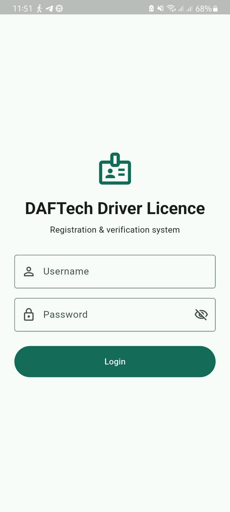
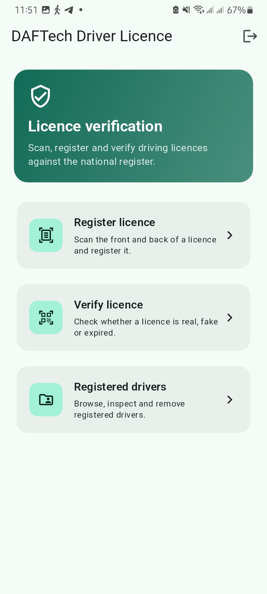
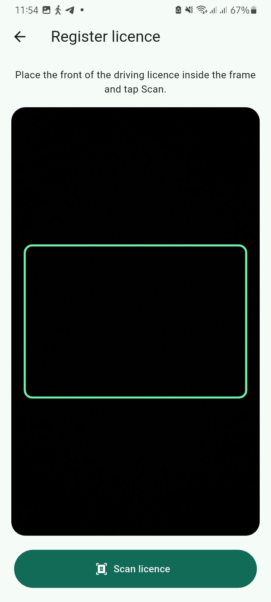
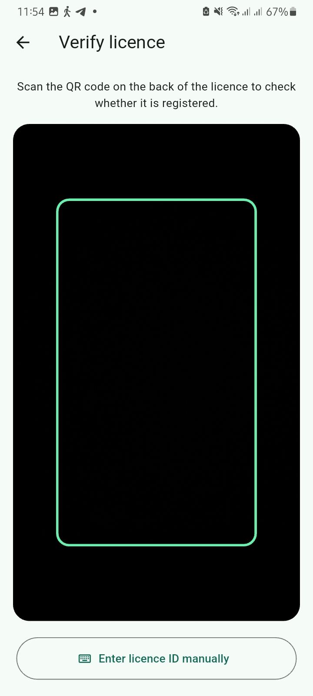

# DAFTech Driver License Verification & Registration System

A full-stack, mobile and backend system designed for traffic officers and enforcement authorities to register, inspect, and verify driving licenses in real time. The solution combines on-device Optical Character Recognition (OCR) and QR barcode scanning with a centralized ASP.NET Core Web API and SQL Server database.

---

## Table of Contents

- [Project Overview](#project-overview)
- [Application Screenshots](#application-screenshots)
- [Key Features](#key-features)
- [Technology Stack](#technology-stack)
- [Project Architecture & Structure](#project-architecture--structure)
- [Database Setup](#database-setup)
  - [Connection String Configuration](#connection-string-configuration)
  - [Applying Migrations](#applying-migrations)
  - [Database Schema & Entities](#database-schema--entities)
  - [Default Seeded Credentials](#default-seeded-credentials)
- [Setup & Installation Instructions](#setup--installation-instructions)
  - [Prerequisites](#prerequisites)
  - [Clone Repository](#clone-repository)
- [How to Run Backend](#how-to-run-backend)
- [How to Run Mobile App](#how-to-run-mobile-app)
- [API Endpoints Reference](#api-endpoints-reference)
- [Troubleshooting & FAQs](#troubleshooting--faqs)

---

## Project Overview

The **DAFTech Driver License System** streamlines traffic enforcement and license registry operations:

1. **Front-Side OCR Scanning**: Captures license card details (Full Name, License ID, Date of Birth, Expiry Date, Category) directly from the physical card using camera text recognition.
2. **Back-Side QR Decoding**: Scans and parses standardized QR codes (including bilingual Amharic/English formats such as `የአሽከርካሪው ስም` and `የመንጃ ፍቃድ ቁጥር`).
3. **Instant Verification Engine**: Validates licenses against the central database to immediately flag whether a license is **Real & Active**, **Expired**, **Needs Review**, or **Fake / Not Found**.
4. **Audit Logging**: Persists every verification scan, timestamp, and inspecting officer ID in an audit log for accountability.

---

## Application Screenshots

| Officer Login | Home Dashboard | Register Licence | Verify Licence |
| :---: | :---: | :---: | :---: |
|  |  |  |  |

---

## Key Features

- **Officer Authentication**: Secure JWT-based authentication using ASP.NET Core Identity.
- **Two-Step Card Intake**: OCR text recognition on card front + QR barcode scanner on card back with live crop and manual adjustment.
- **Status Classification**:
  - `Verified` / `Active`: License exists and expiry date is in the future.
  - `Expired`: License exists in database but has expired.
  - `NeedsReview`: License exists without a confirmed expiry date.
  - `Fake` / `NotFound`: License number does not match any official record.
- **Driver Management Directory**: List, search, inspect, register, and delete driver records.
- **Audit Logs**: Automatic logging of every verification request linked to the inspecting officer.

---

## Technology Used

### Backend (`backend-dotnet`)
- **Runtime & Framework**: [.NET 10](https://dotnet.microsoft.com/) / ASP.NET Core Web API
- **ORM / Data Access**: Entity Framework Core 10 (`Microsoft.EntityFrameworkCore.SqlServer`)
- **Database**: Microsoft SQL Server / SQL Server LocalDB (`MSSQLLocalDB`)
- **Identity & Security**: ASP.NET Core Identity with password hashing, lockout protection, and JWT Bearer tokens (`Microsoft.AspNetCore.Authentication.JwtBearer`)
- **OCR Engine**: Tesseract OCR for .NET (`TesseractOCR` 5.5.2) with trained language datasets
- **API Documentation**: OpenAPI / Swagger (`Swashbuckle.AspNetCore` 10.3.0)

### Mobile App (`mobile_flutter`)
- **Framework & Language**: [Flutter](https://flutter.dev/) (SDK `^3.6.0`) & Dart
- **Design System**: Material Design 3 with custom brand theming
- **Machine Learning & Vision**:
  - `google_mlkit_text_recognition` & `google_ml_kit` for front card text detection
  - `google_mlkit_barcode_scanning` for back QR code decoding
  - `flutter_tesseract_ocr` with offline English trained dataset (`eng.traineddata`)
- **Hardware Integration**:
  - `camera` for live viewfinder preview
  - `image_picker` and `image_cropper` for card framing and cropping
- **State Management & Storage**: `provider` and `shared_preferences` (token persistence)
- **Networking**: `http` with parameterized environment endpoints

---

## Project Architecture & Structure

```plaintext
DAFTech-DriverLicense-System/
├── backend-dotnet/                   # ASP.NET Core 10 Web API
│   ├── Controllers/                  # API Controllers (Auth, Drivers, Verification)
│   ├── Data/                         # AppDbContext & EF Core configuration
│   ├── DTO/                          # Data Transfer Objects
│   ├── migrations/                   # Entity Framework Core migration files
│   ├── Models/                       # Domain models (Driver, User, VerificationLog)
│   │   └── Enums/                    # VerificationStatus enum
│   ├── Properties/                   # launchSettings.json
│   ├── Repositories/                 # Driver and Verification repository layer
│   ├── Services/                     # Business logic (Auth, Driver, JWT, Verification)
│   ├── tessdata/                     # Tesseract trained data files
│   ├── appsettings.json              # Connection strings, JWT configuration
│   ├── Program.cs                    # Application startup, DI, seeding & middleware
│   └── backend-dotnet.csproj         # Project dependencies and build properties
│
└── mobile_flutter/                   # Flutter Cross-Platform Client
    ├── assets/                       # Brand logo & offline Tesseract datasets
    ├── lib/
    │   ├── models/                   # Driver and verification client models
    │   ├── screens/                  # Login, Home, Scanner, Verify, Driver Directory
    │   ├── services/                 # ApiService, AuthService, ApiConfig
    │   ├── utils/                    # License parser, camera converters
    │   ├── widgets/                  # Status chips, custom UI components
    │   └── main.dart                 # Application entry point
    └── pubspec.yaml                  # Flutter package dependencies and assets
```

---

## Database Setup

The backend utilizes **Microsoft SQL Server** via Entity Framework Core Code-First.

### 1. Connection String Configuration
The connection string is configured in [`backend-dotnet/appsettings.json`](backend-dotnet/appsettings.json):

```json
{
  "ConnectionStrings": {
    "DefaultConnection": "Server=(localdb)\\MSSQLLocalDB;Database=DriverLicenseDB;Trusted_Connection=True;TrustServerCertificate=True;"
  }
}
```

> **Note**:
> - If using **SQL Server Express**, change `Server=(localdb)\\MSSQLLocalDB` to `Server=.\\SQLEXPRESS`.
> - If running SQL Server in **Docker**, update the connection string with your container credentials:
>   `Server=localhost,1433;Database=DriverLicenseDB;User Id=sa;Password=YourStrongPassword!;TrustServerCertificate=True;`

### 2. Applying Migrations
The repository includes existing EF Core migrations in the [`backend-dotnet/migrations`](backend-dotnet/migrations) folder (`InitialCreate` and `UpdateVerificationLogRelationship`).

To apply the migrations and create the database schema:

```powershell
# Navigate to the backend directory
cd backend-dotnet

# Ensure dotnet-ef tool is installed (one-time setup)
dotnet tool install --global dotnet-ef

# Apply migrations to create the database and tables
dotnet ef database update
```

### 3. Database Schema & Entities

The database includes the following key tables:

- **`AspNetUsers`**: Officer and administrator accounts, password hashes, and security stamps.
- **`Drivers`**:
  - `DriverId` (Guid, Primary Key)
  - `LicenseId` (string, Unique Alternate Key)
  - `FullName` (string)
  - `DateOfBirth` (DateOnly)
  - `LicenseType` (string)
  - `ExpiryDate` (DateOnly)
  - `QrRawData` (string)
  - `OcrRawText` (string)
  - `CreatedDate` (DateTime, UTC)
  - `RegisteredBy` (Guid, Foreign Key to `AspNetUsers`)
- **`VerificationLogs`**:
  - `LogId` (Guid, Primary Key)
  - `LicenseId` (string)
  - `VerificationStatus` (`Verified`, `Expired`, `NeedsReview`, `NotFound`)
  - `DriverId` (Guid, Nullable Foreign Key to `Drivers`)
  - `CheckedBy` (Guid, Foreign Key to `AspNetUsers`)
  - `CheckedDate` (DateTime, UTC)

### 4. Default Seeded Credentials
When the backend starts up, it automatically checks for and seeds a default authorized officer account if not already present:

- **Username**: `testuser`
- **Email**: `testuser@example.com`
- **Password**: `TestUser@123`

---

## Setup & Installation Instructions

### Prerequisites
Before running the application, make sure you have the following installed:
- [.NET 10 SDK](https://dotnet.microsoft.com/download) (or compatible .NET SDK)
- [Microsoft SQL Server](https://www.microsoft.com/en-us/sql-server) or SQL Server LocalDB (installed with Visual Studio)
- [Flutter SDK](https://docs.flutter.dev/get-started/install) (version 3.6.0 or later)
- Android Studio / Xcode / physical smartphone with developer mode enabled

### Clone Repository
```bash
git clone https://github.com/robelnigusse/DAFTech-DriverLicense-System-.git
cd DAFTech-DriverLicense-System
```

---

## How to Run Backend

1. **Open a terminal** and navigate to the backend directory:
   ```powershell
   cd backend-dotnet
   ```

2. **Restore NuGet packages**:
   ```powershell
   dotnet restore
   ```

3. **Apply the database migrations**:
   ```powershell
   dotnet ef database update
   ```

4. **Run the backend**:

   - **For local testing (Swagger & Local machine)**:
     ```powershell
     dotnet run
     ```
     By default, the server will listen on:
     - HTTP: `http://localhost:5237`
     - HTTPS: `https://localhost:7255`

   - **For Mobile Emulator or Physical Device Access**:
     Bind to `0.0.0.0` on port `5000` so mobile devices on the network can connect:
     ```powershell
     dotnet run --urls "http://0.0.0.0:5000"
     ```
     *(Or with hot reload: `dotnet watch --urls "http://0.0.0.0:5000"`)*

5. **Verify the API**:
   Open your browser and navigate to the interactive Swagger documentation:
   - `http://localhost:5237/swagger` (or `http://localhost:5000/swagger`)

---

## How to Run Mobile App

1. **Open a terminal** and navigate to the mobile app directory:
   ```powershell
   cd mobile_flutter
   ```

2. **Fetch Flutter dependencies**:
   ```powershell
   flutter pub get
   ```

3. **Run on Emulator or Physical Device**:
   The mobile app accepts an environment variable `API_BASE_URL` at compile/run time via `--dart-define`.

   - **Android Emulator** (pointing to your host computer):
     ```powershell
     flutter run --dart-define=API_BASE_URL=http://10.0.2.2:5000/api
     ```

   - **iOS Simulator**:
     ```powershell
     flutter run --dart-define=API_BASE_URL=http://localhost:5000/api
     ```

   - **Physical Mobile Device** (Phone connected via USB or Wi-Fi on the same local network):
     1. Find your computer's local IP address (e.g., `ipconfig` on Windows, look for `IPv4 Address` like `192.168.1.50`).
     2. Run:
        ```powershell
        flutter run --dart-define=API_BASE_URL=http://<YOUR_COMPUTER_IP>:5000/api
        ```

4. **Sign In**:
   Use the pre-seeded credentials:
   - **Username**: `testuser`
   - **Password**: `TestUser@123`

---

## API Endpoints Reference

All secured endpoints require the HTTP Authorization header: `Bearer <JWT_TOKEN>`.

| Method | Endpoint | Description | Auth Required |
|---|---|---|---|
| `POST` | `/api/Auth/login` | Officer login. Returns JWT token and expiry | No |
| `POST` | `/api/Verification/verify` | Verifies a license ID; creates verification log | Yes |
| `GET` | `/api/Drivers` | Retrieves all registered drivers | Yes |
| `POST` | `/api/Drivers` | Registers a new driver license record | Yes |
| `GET` | `/api/Drivers/{id}` | Retrieves driver details by ID | Yes |
| `DELETE` | `/api/Drivers/{id}` | Deletes a driver record | Yes |

---

## Troubleshooting & FAQs

### 1. Mobile app fails with "Connection refused" or network timeout
- If using an **Android emulator**, ensure you set `--dart-define=API_BASE_URL=http://10.0.2.2:5000/api` (Android emulators use `10.0.2.2` to access host machine's `localhost`).
- If using a **physical device**, ensure your computer and phone are connected to the **same Wi-Fi network**, and that Windows Firewall allows inbound connections on port `5000`.
- Ensure the backend was started with `--urls "http://0.0.0.0:5000"`.

### 2. Database connection error when running backend
- Verify SQL Server is running:
  - For LocalDB: run `sqllocaldb info MSSQLLocalDB` and `sqllocaldb start MSSQLLocalDB`.
  - For full SQL Server: ensure the SQL Server Windows service is running.
- Ensure you have executed `dotnet ef database update` before running the API.

### 3. Camera / ML Kit permissions on mobile
- Make sure to accept camera and storage permissions when prompted on the mobile device.
- For testing OCR and QR scanning in Android Emulator, configure the emulator's camera to **VirtualScene** in Android Studio AVD Manager.

---

